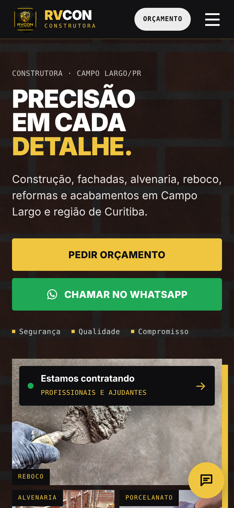
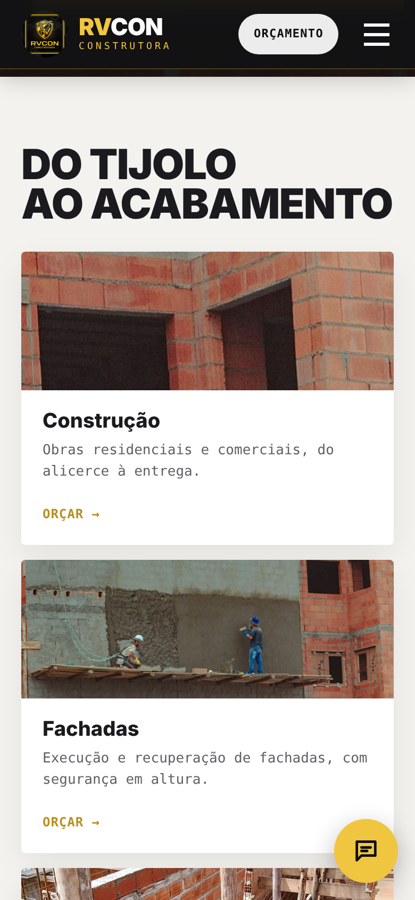
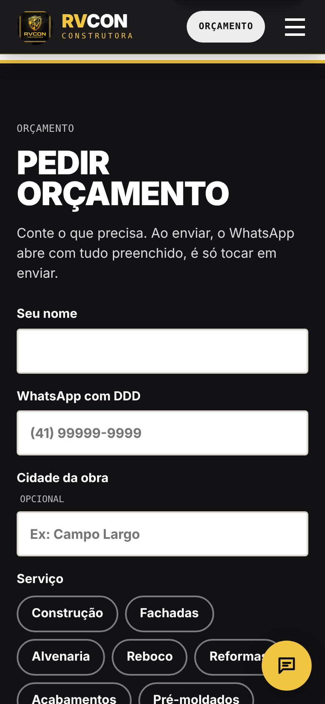
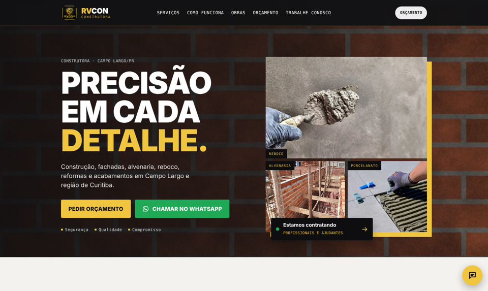
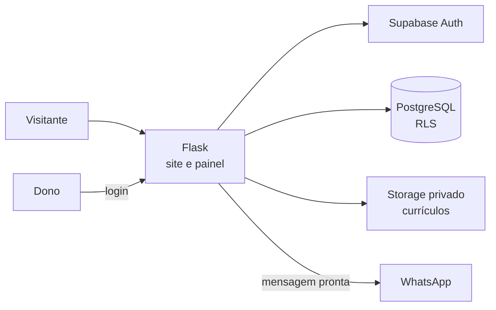

# Site RVCON Construtora

**Site institucional com pedido de orçamento, recebimento de currículos e painel administrativo, desenvolvido para uma construtora real de Campo Largo/PR.**

> Código-fonte privado. Demonstração disponível mediante solicitação.

Projeto feito do levantamento de requisitos com o dono da empresa até a publicação. O foco é o celular, porque é por ele que os clientes chegam (Instagram e WhatsApp) e é por ele que o dono acompanha os pedidos.

---

## Telas

| Início | Serviços | Pedido de orçamento |
|:---:|:---:|:---:|
|  |  |  |

---

## Funcionalidades

- **Pedido de orçamento** salvo no banco, que em seguida abre o WhatsApp da empresa com a mensagem já preenchida.
- **Trabalhe conosco**: o candidato envia o currículo (PDF, Word ou foto do papel, até 5 MB).
- **Painel do dono** em área restrita: lista de orçamentos e currículos, mudança de status, contato direto pelo WhatsApp e download do currículo.
- **Assistente virtual** com respostas prontas para as dúvidas mais comuns.
- Galeria de obras que se atualiza só de colocar a foto na pasta.
- Layout pensado primeiro para o celular e depois ajustado para o computador.

## Tecnologias

| Camada | Tecnologia |
|---|---|
| Back-end | Python com Flask |
| Front-end | HTML, CSS e JavaScript puros (templates Jinja) |
| Banco de dados | PostgreSQL no Supabase |
| Autenticação | Supabase Auth (somente administradores cadastrados) |
| Arquivos | Supabase Storage (bucket privado) |
| Integrações | API REST do Supabase, WhatsApp |
| Publicação | Render com Gunicorn |

## Arquitetura

## Destaques técnicos

**Segurança dos dados**
- Row Level Security em todas as tabelas: o visitante só consegue **enviar** orçamento e currículo. Ler, alterar ou apagar exige login de um usuário cadastrado como administrador.
- O site usa apenas a chave pública do Supabase. Mesmo que alguém a copie do navegador, as regras do banco impedem acesso aos dados.
- Currículos em bucket privado. O painel gera um link de download que expira em 5 minutos.
- Validação do arquivo pelo conteúdo real (não só pela extensão) e limite de tamanho no servidor.
- Cadastro público desativado: só entra no painel quem o administrador cadastrar.

**Proteção do site**
- Proteção contra CSRF em todos os formulários.
- Limite de envios por IP no orçamento, no currículo e no login, contra spam e tentativas de senha.
- Cookies de sessão protegidos (HttpOnly, SameSite e Secure em produção).
- Sessão do painel com renovação automática do token.
- Chaves e senhas fora do código, em variáveis de ambiente. A chave da sessão é gerada pela própria hospedagem.

**Cuidado com o usuário**
- Dados pessoais de candidatos tratados com acesso restrito, pensando na LGPD.
- Fotos tratadas e otimizadas para carregar rápido no celular.

---

## Autora

**Geanine Silva**
Business Intelligence | Power BI | Análise e Desenvolvimento de Sistemas (PUCPR)

[LinkedIn](https://linkedin.com/in/geanine-silva-307899b5/)
